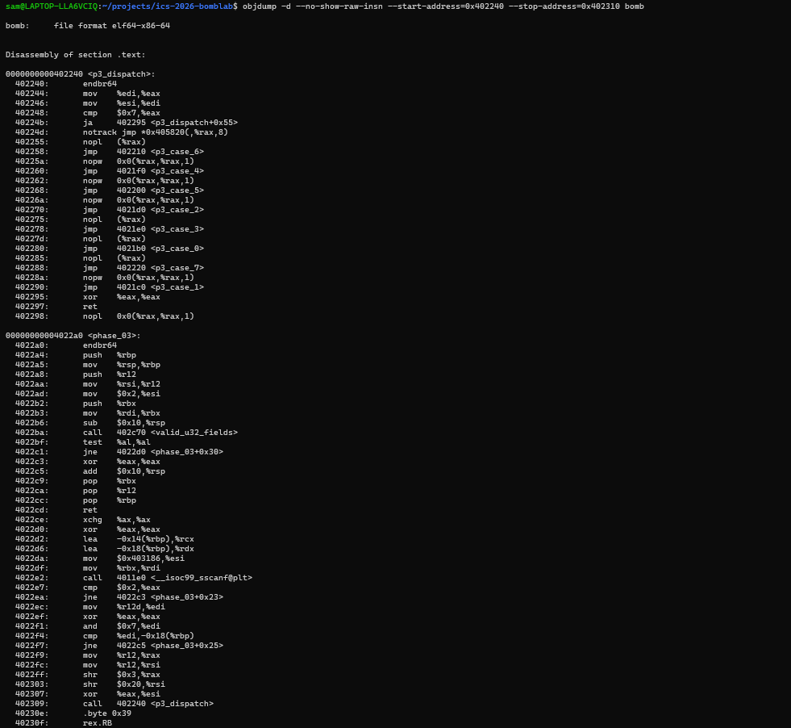
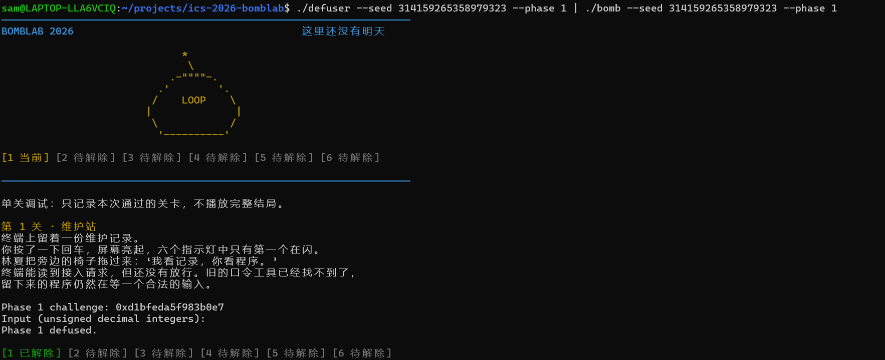
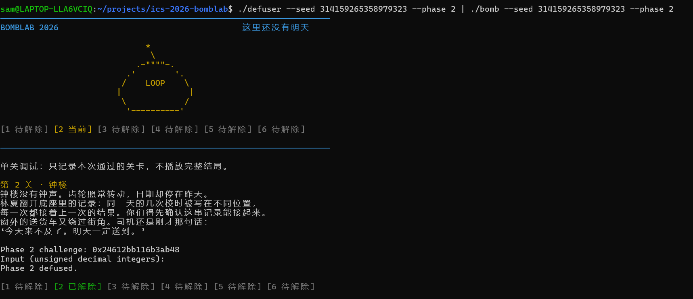
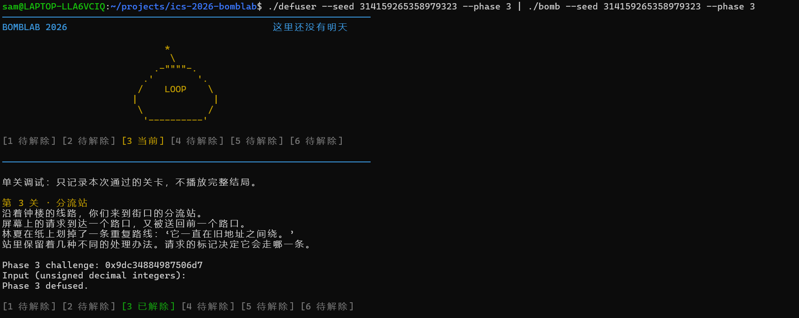
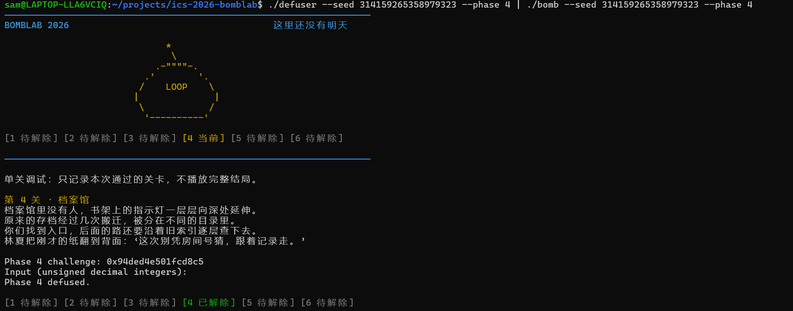
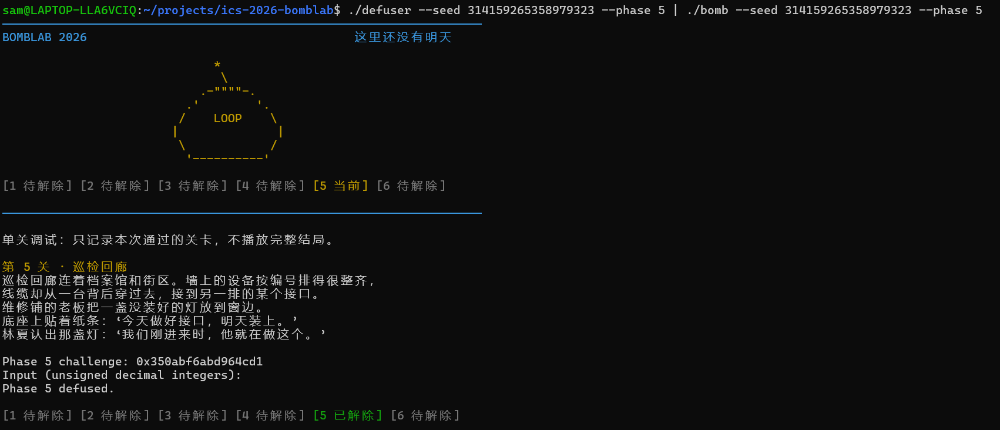
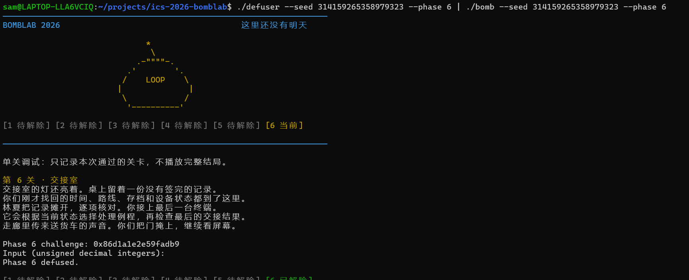

# BombLab 实验报告

> 姓名：`[待补充（可选）]`  
> 学号：`[待补充（可选）]`  
> 完成日期：2026-10-30

## 1. 实验目标与完成情况

本实验的目标是阅读给定的 x86-64 可执行文件，恢复每个检查函数对输入的计算关系，并在 `defuser.c` 中实现随 `challenge` 改变的求解函数。实现没有修改 `defuser.c` 以外的课程驱动、测试脚本或炸弹文件。

已完成 Phase 1--6 与 Honor Secret Phase。所有整数运算以下均按 `uint32_t` 的模 \(2^{32}\) 语义理解；右移为无符号右移。

## 2. 方法与工具

我先用 `nm -n bomb` 定位各 Phase 与辅助函数，再用 `objdump -d --no-show-raw-insn` 阅读关键基本块，并以 GDB 在解析完成或比较前的断点观察局部变量、寄存器和输入缓冲区。恢复关系后，将其实现为 `defuser.c` 中的纯计算函数；通过 `write_answer` 统一产生一行无符号十进制整数。

本实验还使用了课程提供的 `make`、`public_test.py`、`runner.py` 和 `tests/public.json` 进行编译、格式检查及公开测试。对 Honor 调试时，使用 GDB 观察 `secret_gate` 与 `secret_phase` 的栈上偏移；未使用 GDB 修改炸弹的寄存器、内存或控制流来绕过检查。



图 1 展示了 `p3_dispatch` 中的范围检查和 `notrack jmp *0x405820(,%rax,8)` 跳转表，以及 `phase_03` 对两个整数输入的解析与第一项检查。

## 3. 各 Phase 的逆向分析与计算关系

### Phase 1：函数调用、参数传递与返回值

`phase_01` 先以 `sscanf` 读取一个无符号 32 位整数，然后调用 `p1_compute(challenge)`，将返回值与输入比较。`p1_compute` 将同一 64 位 `challenge` 的不同截断/移位结果传入三个辅助函数；例如 `p1_step1` 中的 `lea (%rdi,%rdi,4), %eax` 对应乘 5，`p1_step0` 中的 `sub` 和 `lea 0x8223(...)` 对应减法后乘 5 加常数。

令

\[
H=(uint32\_t)(challenge\gg32),\quad
M=(uint32\_t)(challenge\gg16),\quad
L=(uint32\_t)challenge.
\]

恢复出的关系为：

\[
A=(5H+M)\oplus0x18df,
\]
\[
B=5(L-H)+0x8223,
\]
\[
R=(5B)\oplus(A+0x88bc).
\]

输出单个整数 `R`。



### Phase 2：数组、循环与递推

`phase_02` 要求恰好六个输入字段。其循环从 `edx=1` 开始，每轮把提取出的 4-bit 值、循环下标和前一项异或，再用 `lea (%rax,%rax,2)` 实现乘 3；`ecx` 从 22 开始每轮增加 5，说明每项使用不同的移位位置。

令输出数组为 `v[0..5]`。恢复关系为：

\[
v_0=20+2\left((challenge\gg31)\mathbin{\&}0xf\right),
\]

对 \(i=1,\ldots,5\)：

\[
n_i=(challenge\gg(22+5(i-1)))\mathbin{\&}0xf,
\]
\[
v_i=3\big((n_i+i)\oplus v_{i-1}\big).
\]

按 `v[0] ... v[5]` 的顺序输出六个整数。



### Phase 3：switch 分支与跳转表

`phase_03` 读取两个整数。第一个值必须为 `challenge & 7`；随后 `p3_dispatch` 对该值做范围检查，并以 `notrack jmp *table(,%rax,8)` 进入八个分支之一。根据跳转表目标和各分支的 `lea`、`xor`、`shr` 指令，恢复出分支计算。

令

\[
x=challenge\mathbin{\&}7,\qquad
k=(uint32\_t)(challenge\gg3)\oplus(uint32\_t)(challenge\gg32).
\]

第二个输出 `y` 为：

| `x` | `y` |
| --- | --- |
| 0 | \((2k)\oplus0xa287\) |
| 1 | \(3k+0xa70d\) |
| 2 | \((k\oplus0x346)+(k\gg1)\) |
| 3 | \(5k+0x2fc0b\) |
| 4 | \((k\oplus0x189c)+(k\gg2)\) |
| 5 | \((2k)\oplus0x737d\) |
| 6 | \(5k+0xdf66\) |
| 7 | \(3k+0x112c\) |

输出为 `x y`。



### Phase 4：递归调用与返回过程

`phase_04` 从 `challenge` 取低 7 位作为目标值 `a`，将其余派生值作为 `d`，然后调用递归函数 `p4_walk(a, 0, 127, d)`。函数首先以 `(low + high) / 2` 取中点；中点相等时直接返回；否则递归至左/右半区，在返回路径上执行 `3*t`、异或 `(m+d)`，并分别异或常数 `0x13` 或 `0x16`。

令

\[
a=challenge\mathbin{\&}0x7f,\qquad
d=(uint32\_t)(challenge\gg7)\oplus(uint32\_t)(challenge\gg32).
\]

定义 \(F(a,b,c,d)\)，其中 \(m=b+\lfloor(c-b)/2\rfloor\)：

\[
F=\begin{cases}
(m+0xd6)\oplus d,&a=m;\\
\big(3F(a,b,m-1,d)\oplus(m+d)\big)\oplus0x13,&a<m;\\
\big(3F(a,m+1,c,d)\oplus(m+d)\big)\oplus0x16,&a>m.
\end{cases}
\]

输出为 `F(a, 0, 127, d)`。



### Phase 5：结构体布局、指针与链表遍历

`p5_traverse` 将节点指针从表中取出，访问偏移 0、4、8 处的数据。由访存方式可恢复节点布局为 `value`、`tag`、`next` 三个字段。低 3 位选择起始节点，`(challenge >> 3) & 3` 决定跟随 `next` 的次数；每次都更新累计值和最后访问节点的 `tag`。

令

\[
s=challenge\mathbin{\&}7,\quad q=(uint32\_t)(challenge\gg3),\quad
h=(uint32\_t)(challenge\gg6)\oplus(uint32\_t)(challenge\gg32).
\]

从反汇编中的静态表恢复的数据如下（下标从 0 开始）：

| 数组 | 恢复出的内容 |
| --- | --- |
| `start` | `[4, 0, 2, 1, 8, 11, 5, 9]` |
| `value` | `[16315, 29470, 23152, 38726, 15944, 31985, 37551, 29109, 62349, 37085, 49171, 52872]` |
| `tag` | `[801, 2614, 111, 1624, 1838, 1392, 371, 2353, 520, 1098, 2091, 2937]` |
| `next` | `[2, 8, 1, 7, 0, 9, 10, 0, 11, 6, 3, 5]` |

初始值为

\[
r=5\big((h\oplus0xa252)+value[index]\big)\oplus tag[index].
\]

随后循环 `q & 3` 次：先令 `index = next[index]`，再计算

\[
r=5(r+value[index])\oplus tag[index].
\]

输出为最终的 `r` 和最后访问节点的 `tag`。



### Phase 6：函数指针表与间接调用

`p6_dispatch` 先从 `challenge` 派生参数 `k`，再以两组 3-bit 索引从地址 `0x405e00` 的函数指针表中进行两次间接调用：`call *0x405e00(,%rax,8)` 和 `call *0x405e00(%rbx)`。六个候选操作的关键指令分别表现为逻辑右移、`ror`、`rol`、移位、加法和异或。

令

\[
a=challenge\mathbin{\&}7,\quad b=(challenge\mathbin{\&}0x38)\gg3,
\]
\[
k=(uint32\_t)(challenge\gg6)\oplus(uint32\_t)(challenge\gg32).
\]

根据函数指针表，索引映射为

\[
mapping=[3,5,4,2,1,0,4,3].
\]

令 `op` 为表项所指的操作。六个操作由候选函数恢复如下：

| 编号 | `op(j, x)` |
| --- | --- |
| 0 | \((x\oplus(x\gg5))+0xab9b\) |
| 1 | \(ror_2(x)\) |
| 2 | \(rol_7(x)\oplus0xf19f\) |
| 3 | \(((x\ll7)+0x44d8)\oplus3x\) |
| 4 | \((x\oplus0x444d)+(x\ll7)\) |
| 5 | \((x+0xa303)\oplus(x\gg7)\) |

令 `T(i,x)=op(mapping[i & 7],x)`。最终关系为

\[
u=T(a,k)\oplus0x1986,
\]
\[
R=T(b,u)+0x5880.
\]

输出单个整数 `R`。



### Honor Secret Phase：输入布局、上下文与三项校验

Honor 的 `solve_secret` 同时使用 `challenge` 和前六关输出导出的 `context`。`secret_phase` 使用 `sscanf` 解析三个无符号整数，并依次比较 `x1`、`x2`、`x3`。`secret_mix` 的 `rol $1`、`add $0xc64`、`xor $0x785b` 对应一次 32 位循环左移及两个常数运算。

令

\[
A=(uint32\_t)challenge,\quad B=(uint32\_t)(challenge\gg32),
\]
\[
C=(uint32\_t)context,\quad D=(uint32\_t)(context\gg32),
\]
\[
u_1=A\oplus B,\qquad u_2=C\oplus D.
\]

恢复出的三个字段为：

\[
x_1=C\mathbin{\&}3,
\]
\[
x_2=\big(rol_1(u_1\oplus u_2)+0xc64\big)\oplus0x785b\oplus
\big((x_1\cdot0xc64)\oplus(uint32\_t)(context\gg16)\big),
\]
\[
x_3=x_2\oplus\big(u_2+x_1+0x785b+(u_1\gg1)\big).
\]

调试过程中，最初的 Honor 输入未进入 `secret_phase`。在 `secret_gate` 中，输入缓冲区起点为 `rbp-0xd0`，而 `cmpl $0x4e45504f,-0xb0(%rbp)` 比较的是偏移 \(0x20=32\) 的四个字节，即小端编码的 `OPEN`。随后 `lea -0xac(%rbp), %rdi` 将 `buffer+36` 作为 `secret_phase` 的字符串起点。因此正确格式为：32 个空格、`OPEN`、再接三个整数。实现使用 `memset(out, ' ', 32)` 后在 `out+32` 格式化 `OPEN%u %u %u`。

这一步说明，仅看比较常数不足以确定输入格式；还必须结合基址与栈偏移确认被检查的实际字节位置。


图中 `0x20` 连续出现 32 次；其后的 `0x4f 0x50 0x45 0x4e` 为 ASCII 字符 `OPEN`，且以 32 位小端字显示为 `0x4e45504f`。

## 4. 验证记录

课程公开种子来自 `tests/public.json`：`0, 1, 7, 42, 99, 123, 2026, 65535, 987654321, 18446744073709551615`。2026-10-30 在当前工作区执行 `python3 public_test.py`，得到：

| 测试范围 | 结果 |
| --- | --- |
| Phase 1--6（10 个公开 seed × 6） | `Public tests: 60/60` |
| Honor Secret Phase（10 个公开 seed） | `Secret public tests: 10/10` |

此外，为满足“公开列表外 seed”的验证要求，使用未列在 `tests/public.json` 中的 seed `314159265358979323` 执行：

```sh
{ ./defuser --seed 314159265358979323; \
  ./defuser --secret --seed 314159265358979323; } \
  | ./bomb --seed 314159265358979323
```

运行结果依次显示 `Phase 1 defused.` 至 `Phase 6 defused.`、`Congratulations! You've defused the bomb.` 和 `Secret phase defused.`，说明该非公开 seed 下的六关与 Honor 均通过。


## 5. 结论与反思

六个普通 Phase 与 Honor 已完成。实现将每关的汇编关系写成参数化计算，而非为某一个 seed 写死答案；公开测试和一组公开列表外 seed 均通过。实验中最重要的收获是：对寄存器级计算的理解需要和数据布局、调用约定及地址偏移结合验证，尤其在 Honor 中，输入字符串的正确位置由栈上偏移决定。

## 6. 资料与辅助工具说明

1. 课程仓库 `README.md`：实验规则、报告要求、测试命令与公开测试范围。
2. 课程仓库 `teaching/README.md`：GDB 与 x86-64 观察方法的教学说明。
3. GNU Binutils `objdump` 与 GDB：用于静态反汇编和动态观察；未用于修改炸弹状态或绕过检查。
4. ChatGPT/Codex：用于解释已观察到的汇编、讨论验证方式、定位 Honor 输入偏移问题，以及整理本报告。最终公式、实现和测试结果均以本人的代码、反汇编观察和本地运行结果核对；相关终端与 GDB 截图已作为图 1--9 嵌入报告。

